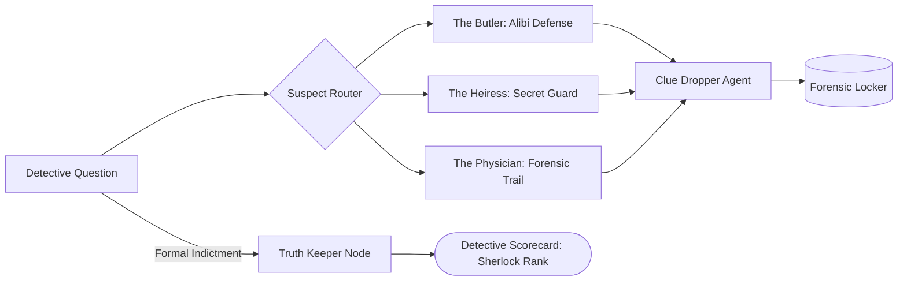

<div align="center">

# Prajwal Rao

### **AI Systems Builder & Tech Enthusiast**
*Tinkering at the frontier of Autonomous Agents · Stateful Orchestration (LangGraph) · Model Context Protocol (MCP) · LLM Systems*

[](https://github.com/Riser01)
[](https://www.linkedin.com/in/prajwal-rao-d/)
[](#what-im-exploring)
[](#tech-stack)

---

```
"Building systems that reason, remember, and act in the physical and digital world."
```

</div>

---

## ⚡ The Spark

Senior Applied Data Scientist by profession, open-source AI builder and tech enthusiast by obsession. 

I'm deeply fascinated by the shift from passive next-token prediction to **proactive, stateful multi-agent systems** that can plan, coordinate, debate, and reliably interact with software and databases. My weekend builds focus on turning bleeding-edge ideas into runnable code — from cyclic deduction graphs in LangGraph to tool integration using Anthropic's Model Context Protocol (MCP), fine-tuning small models with LoRA/DPO, and building rigorous LLM-as-a-judge evaluation frameworks.

---

## 🧠 What I'm Exploring

- **Stateful Cyclic Graphs (LangGraph):** Building multi-agent systems with independent memory checkpointers, parallel stateful nodes, dynamic routing, and human-in-the-loop validation.
- **Model Context Protocol (MCP):** Implementing standards-compliant JSON-RPC agent tool servers that decouple reasoning from data stores while enforcing role-based boundaries (RBAC) and database concurrency.
- **Agentic Evaluation & Anti-Sycophancy:** Designing automated evaluation harnesses (LLM-as-a-Judge, adversarial simulation panels, and benchmark validation) that test edge cases and prevent hallucination.
- **Model Fine-Tuning & Distillation:** Experimenting with parameter-efficient fine-tuning (LoRA, QLoRA, DPO, GRPO) to distill high-reasoning capabilities into fast, localized open weights.

---

## 🚀 Featured Builds & Experiments

### 🥇 [Murder Mystery Engine & Autonomous Agent Arena](https://github.com/Riser01/Personal-Projects)
> **Interactive multi-agent deduction game with independent stateful personas and forensic ground-truth validation.**

- **Concept:** Every suspect is an autonomous, stateful LangGraph node with their own personality, secrets, and alibis. The user interrogates them as detective, unlocking physical/forensic clues in real time.
- **Architecture:** `Plot Architect` → `Stateful Suspect Nodes` (parallel memory checkpointers) → `Clue Dropper Node` (intent & keyword recognition) → `Truth Keeper Node` (indictment deduction evaluation).
- **Playable Anywhere:** Features both an interactive **Terminal CLI** (`python play.py`) and a sleek **Web Arena** (`python app.py`) with sub-second latency via **Gemini 2.0 Flash** and deterministic offline simulation.
- **Stack:** `Python 3.12`, `LangGraph`, `Gemini 2.0 Flash`, `FastAPI`, `Pytest (18 passing tests)`.



---

### 🥈 [PropAgent MCP: Multi-Agent Property Operations](https://github.com/Riser01/Personal-Projects/tree/master/docs)
> **Autonomous residential operations coordinating tenants, owners, and management via Gemini and Model Context Protocol.**

- **Concept:** Multi-persona agent pipeline (`Tenant Agent`, `Owner Agent`, `Admin Agent`, `Supervisor FSM`) communicating over MCP to manage apartment move logistics.
- **Highlights:** Concurrency-safe service elevator reservation using lazy-TTL mutex locks; digital gate pass generation with 6-digit OTP verification; human-in-the-loop approval checkpoints.
- **Stack:** `Python 3.11+`, `FastAPI`, `Model Context Protocol (MCP)`, `aiosqlite WAL`, `Pytest (28 tests passing)`.

---

### 🥉 [InterviewForge: Technical Interview Simulator](https://github.com/Riser01/interviewforge)
> **Context-grounded technical interview simulator with realistic interviewer personas and dynamic pushback.**

- **Concept:** Calibrates pushback against uploaded Job Descriptions and candidate resumes, probing distributed systems tradeoffs, sharding, and latency budgets without sycophantic praise.
- **Stack:** `Next.js 15`, `LangGraph.js`, `Gemini 2.0 Flash`, `Tailwind CSS`, `Vitest`.

---

### 📈 [Residential Usage Prediction System](https://github.com/Riser01/residential-usage-prediction)
> **Multi-target machine learning pipeline forecasting facility utilization across residential communities.**

- **Highlights:** Feature engineering pipeline benchmarking LightGBM against historical baseline models with chronological validation and automated CI quality gates.
- **Stack:** `Python`, `Scikit-Learn`, `LightGBM`, `Pandas`, `Pytest`, `GitHub Actions`.

---

## 🛠️ Tech Stack & Toolkit

| Category | Tools & Frameworks |
|---|---|
| **Agent Orchestration** | **LangGraph**, LangChain, StateGraph, Memory Checkpointers, Copilot Studio, Semantic Kernel |
| **Protocols & Tooling** | **Model Context Protocol (MCP)**, REST APIs, SSE Streaming, JSON-RPC 2.0, WebSocket |
| **LLMs & GenAI** | **Google Gemini 2.0 Flash**, OpenAI GPT-4o / GPT-5, Claude 3.5 Sonnet, vLLM, RAG |
| **Fine-Tuning & ML** | **PyTorch**, LoRA, QLoRA, DPO, GRPO, HuggingFace, Scikit-Learn, LightGBM |
| **Backend & Persistence** | **Python 3.12**, **FastAPI**, Uvicorn, SQLite WAL, PostgreSQL, Redis, Qdrant |
| **Frontend & Visualization** | **TypeScript**, Next.js, Tailwind CSS, Vanilla JS, HTML5 Canvas |
| **Testing & MLOps** | **Pytest**, MLflow, Docker, GitHub Actions, Azure ML Studio, Databricks |

---

## 🤝 Let's Connect

Always excited to chat about agentic architectures, autonomous systems, open-source AI tooling, or interesting research papers:

- **LinkedIn:** [linkedin.com/in/prajwal-rao-d](https://www.linkedin.com/in/prajwal-rao-d/)
- **GitHub:** [@Riser01](https://github.com/Riser01)
- **Email:** [prajwalrao56@gmail.com](mailto:prajwalrao56@gmail.com)
