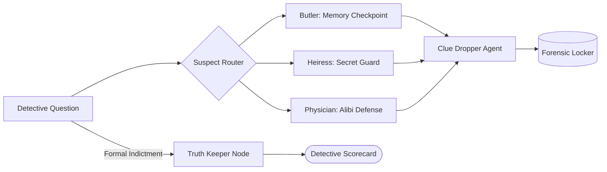

<div align="center">

# Prajwal Rao

### **AI Agent & Distributed Systems Engineer**
*Multi-Agent Orchestration (LangGraph) · Model Context Protocol (MCP) · Production-Grade LLM Systems*

[](https://github.com/Riser01)
[](mailto:prajwalrao56@gmail.com)
[-blue?style=flat)](https://github.com/Riser01)
[](#contact--collaboration)

---

```
"Agents are not prompts; they are state machines with tools, checkpoints, and rigorous evaluation."
```

</div>

---

## ⚡ What I Build

I design and deploy **autonomous multi-agent architectures**, **stateful orchestration graphs**, and **context-grounded LLM systems**. My work focuses on moving beyond naive single-prompt wrappers into deterministic, production-ready agent harnesses:

- **Stateful Cyclic Graphs (LangGraph):** Multi-agent coordination with memory checkpointers, human-in-the-loop approval gates, and parallel branch execution.
- **Model Context Protocol (MCP):** Standards-compliant JSON-RPC stdio/SSE tool servers enforcing strict role-based boundaries (RBAC) and database concurrency.
- **Anti-Sycophancy & Adversarial Evaluation:** Calibration pipelines that challenge shallow answers, detect hallucinations, and evaluate outputs against ground-truth rubrics.

---

## 🚀 Flagship & Featured Projects

### 🥇 [Murder Mystery Engine & Autonomous Agent Arena](https://github.com/Riser01/Personal-Projects)
> **Interactive multi-agent deduction game with independent stateful personas and forensic ground-truth validation.**

- **Architecture:** `Plot Architect` → `Stateful Suspect Nodes` (parallel memory checkpointers) → `Clue Dropper Node` (keyword & intent trigger) → `Truth Keeper Node` (indictment validation).
- **Key Capabilities:** Playable via interactive **Terminal CLI** (`python play.py`) and **Visual Web Arena** (`python app.py`). Features zero-friction deterministic simulation + live **Gemini 2.0 Flash**.
- **Tech Stack:** `Python 3.12`, `LangGraph`, `Gemini 2.0 Flash`, `FastAPI`, `Pytest (13 tests passing)`.



---

### 🥈 [PropAgent MCP: Multi-Agent Property Management](https://github.com/Riser01/Personal-Projects/tree/master/docs)
> **Autonomous residential operations coordinating tenants, owners, and management via Gemini and MCP.**

- **Architecture:** Multi-persona agent pipeline (`Tenant Agent`, `Owner Agent`, `Admin Agent`, `Supervisor FSM`) communicating over Model Context Protocol (MCP) with role-based access control.
- **Key Capabilities:** Prevents double-booking elevator slots with lazy-TTL mutex locks; generates 6-digit OTP security gate passes; includes human-in-the-loop approval workflows.
- **Tech Stack:** `Python 3.11+`, `FastAPI`, `Model Context Protocol (MCP)`, `aiosqlite WAL`, `Pytest (28 tests passing)`.

---

### 🥉 [InterviewForge: AI Technical Interview Simulator](https://github.com/Riser01/interviewforge)
> **Context-grounded mock technical interview simulator with calibrated multi-turn pushback.**

- **Architecture:** Ingests target company Job Descriptions and candidate resumes to calibrate interviewer rigor (FAANG Bar Raiser vs. Mentor), probing distributed system scale limits and failure modes.
- **Tech Stack:** `Next.js 15`, `LangGraph.js`, `Gemini 2.0 Flash`, `Tailwind CSS`, `Vitest`.

---

### 📊 [Residential Usage Prediction System](https://github.com/Riser01/residential-usage-prediction)
> **Production ML pipeline predicting multi-target facility utilization with chronological cross-validation.**

- **Architecture:** Engineered feature extraction pipeline benchmarking LightGBM against historical baseline models, delivering measurable lift across all booking dimensions.
- **Tech Stack:** `Python`, `Scikit-Learn`, `LightGBM`, `Pandas`, `Pytest`, `Automated CI Pipeline`.

---

## 🛠️ Technical Stack & Core Competencies

| Domain | Technologies & Frameworks |
|---|---|
| **Agent Orchestration** | **LangGraph**, LangChain, StateGraph, Memory Checkpointers, Cyclic Topologies |
| **Tooling & Protocols** | **Model Context Protocol (MCP)**, REST APIs, SSE Streaming, WebSocket |
| **LLMs & GenAI** | **Google Gemini 2.0 Flash**, OpenAI GPT-4o, Claude 3.5 Sonnet, Structured Function Calling |
| **Backend & Systems** | **Python 3.12**, **FastAPI**, Uvicorn, SQLite WAL, PostgreSQL, Redis |
| **Frontend & UI** | **TypeScript**, Next.js, Tailwind CSS, Vanilla JS / HTML5 |
| **Testing & CI/CD** | **Pytest**, Vitest, Playwright, GitHub Actions, Docker |

---

## 🏛️ Engineering Philosophy

1. **Verify Before Done:** No feature is complete without automated regression tests and reproducible CLI/web evidence.
2. **Deterministic Fallbacks:** AI systems must fail gracefully. Every agent service includes deterministic mock modes for seamless offline evaluation.
3. **Observability First:** Transparent state inspection, structured logs, and scorecards over black-box prompt chains.

---

## 📬 Contact & Collaboration

- **Email:** [prajwalrao56@gmail.com](mailto:prajwalrao56@gmail.com)
- **GitHub:** [@Riser01](https://github.com/Riser01)
- **Location:** India (Available for Global Remote & Relocation)
- **Role Focus:** Staff / Lead AI Engineer · AI Systems Architect · Agentic Workflows Lead
